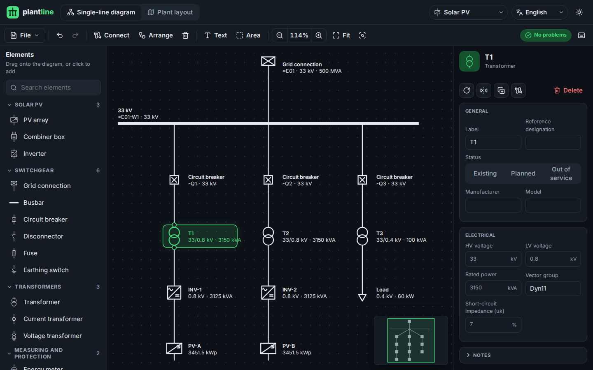
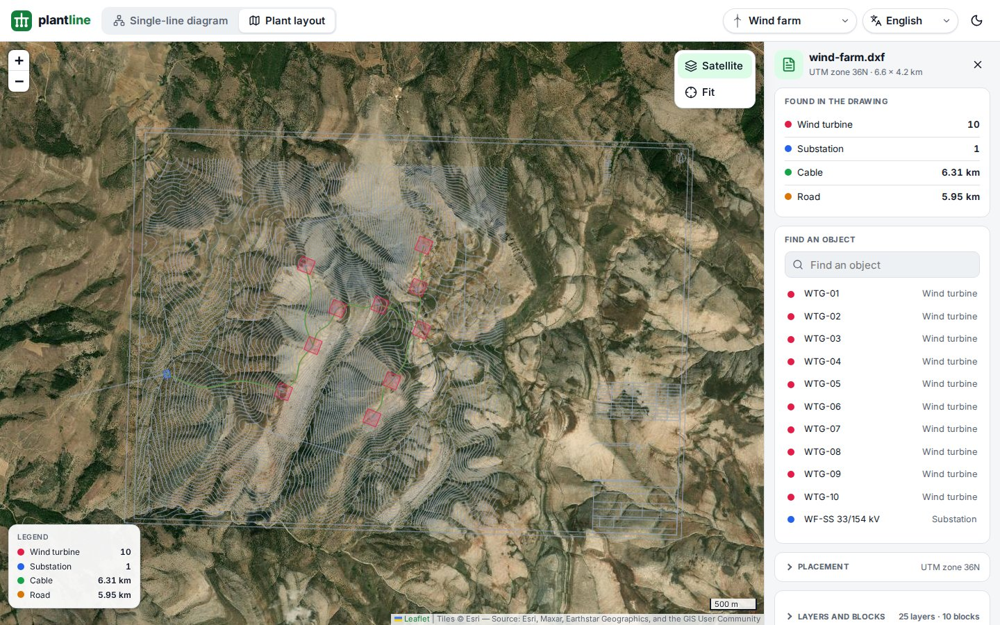
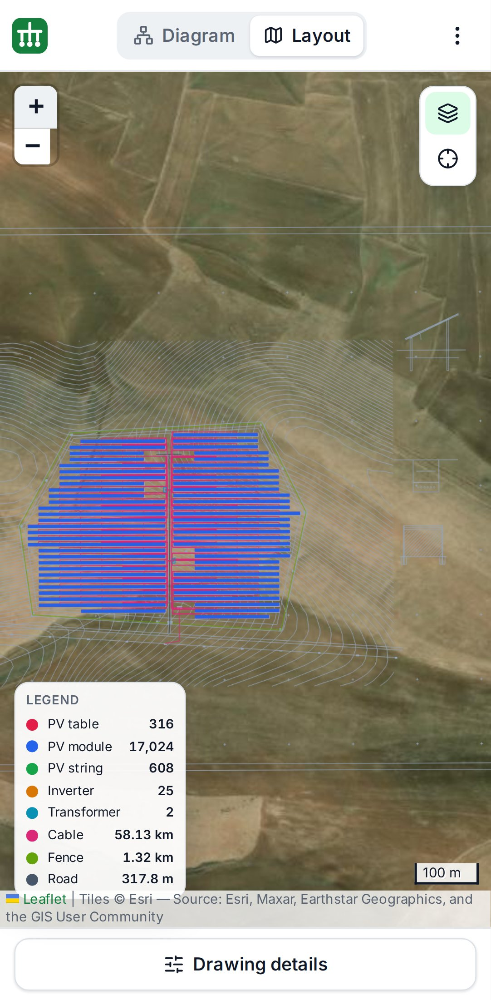
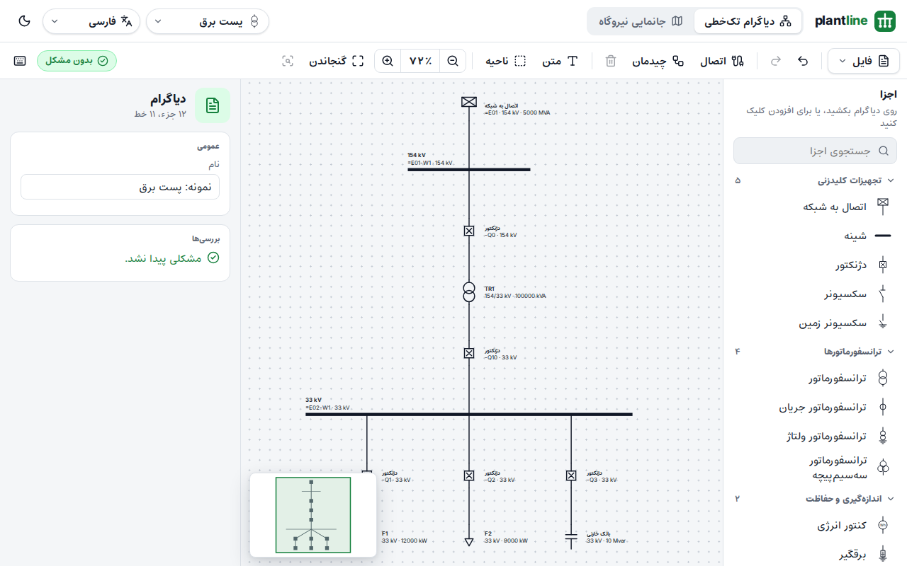

<h1>
  <picture>
    <source media="(prefers-color-scheme: dark)" srcset="docs/images/logo-dark.png">
    
  </picture>
</h1>

> **Single-line diagrams and DWG/DXF plant layouts in your browser, for solar, wind, storage, hydro, substations and transmission lines. Free and open source.**

[](https://github.com/araminix/plantline/actions/workflows/ci.yml)
[](LICENSE)
[](https://araminix.github.io/plantline/)

plantline is a web tool for the people who design, build and run power plants. Draw the plant's **single-line diagram**, open its **AutoCAD drawing**, and see the plant **on the map** with its tables, inverters, turbines, towers and cables found and counted. It needs no account and no server: everything runs in your browser, and your files never leave your computer.

**[Try it online](https://araminix.github.io/plantline/)** (every plant type has a sample drawing), run it on your own machine, or fork it and make it yours.



## What it does

### Single-line diagrams

- **Start from the plant type.** Solar PV, wind farm, battery storage, hydropower, substation or transmission line: the palette shows that plant's equipment first (PV arrays and inverters, wind turbines, batteries, generators, overhead lines…), then the switchgear every plant has.
- **Draw** with 23 element types in the style of IEC 60617: drag an element from the palette onto the grid (or tap it), drag from a connection point to another element to connect them, drag a line's segments to shape it, or make it straight.
- **Edit groups:** select an area as in CAD, copy and paste, rotate and flip, align and space evenly, nudge with the arrow keys; resize busbars by their ends and move labels where they read best.
- **Annotate** with texts and dashed areas around bays and stations.
- **Navigate** with the zoom level, 100 %, zoom to selection and an overview map; every shortcut is on one sheet (press `?`).
- **Arrange automatically.** One click lays the diagram out top-down from the grid connection, with busbars long enough for their feeders.
- **Describe** each element with the data of its kind: a transformer's HV and LV voltage, rated power, vector group and impedance; an inverter's AC and DC power; a PV array's modules and strings; ratings, currents, status (existing, planned, out of service), manufacturer, model and notes. Lines have their kind, length, conductor and cross-section. Planned equipment is drawn dashed.
- **Check** before you share: a missing grid connection, unconnected elements, different voltages where a line meets an element (each side of a transformer on its own), an inverter with its DC and AC sides mixed up, PV modules that do not add up, a designation used twice.
- **Undo and redo** everything; the diagram is kept in your browser between visits.
- **Save and open** diagram files (`.plantline.json`), **export** SVG and PNG, or **print** and save as PDF.

### Plant layouts from AutoCAD drawings



- **Open DWG or DXF** drawings from AutoCAD, PVcase or any CAD tool, up to 100 MB. The drawing is read in your browser.
- **Recognise the plant:** block and layer names are matched to tables, strings, inverters, turbines, batteries, transformers, breakers, towers, cables, roads and fences. Each plant type has its own rules, and you can edit them.
- **Count and measure:** objects are counted, cables, lines, roads and fences measured in metres, and a solar plant's installed capacity worked out from its tables.
- **Place it on the map** in the drawing's own coordinates (a UTM zone or any proj4 system) or on a point you choose, with a rotation, over a plain map or satellite imagery.
- **Export** the recognised objects as GeoJSON and the totals as CSV.

### For everyone, everywhere

- **14 languages:** English, 中文, हिन्दी, Español, Français, العربية, فارسی, Português, Русский, 日本語, Deutsch, 한국어, Türkçe and Italiano, with Arabic and Persian right to left.
- **Light and dark themes.**
- **Phones and tablets:** panels become sheets, and the diagram pans and zooms with your fingers.

| Phone, plant layout | Arabic, right to left |
| --- | --- |
|  |  |

## Your files stay yours

- **No account, no server, no tracking.** The site is static files; the app sends nothing anywhere.
- **Drawings are read in your browser**, in a background worker of their own, and never uploaded.
- **Diagrams are kept in your browser** and in the files you save; for the drawings you open, only their settings (unit, place on the map, your choices) are remembered, never the drawings.

The only things fetched from elsewhere are map tiles (OpenStreetMap and Esri), and only for the part of the map you look at.

## Run it yourself

You need Node.js 22 or later, pnpm 11, and the .NET 10 SDK (only to build the drawing reader).

```bash
git clone https://github.com/araminix/plantline.git
cd plantline/web
pnpm install
pnpm cad      # builds the DWG/DXF reader into public/cad (once, and after changing cad/)
pnpm dev      # http://localhost:5173
```

`pnpm build` writes a static site to `web/dist` that any web server can host; set `BASE_PATH` when it is served from a sub-path (`BASE_PATH=/plantline/ pnpm build`). Pushes to `main` publish it on GitHub Pages ([CI](.github/workflows/ci.yml)).

## How it works

```
plantline/
├── web/                React + TypeScript app (Vite): diagrams, map, languages, themes
│   ├── src/diagram/    model, undo history, checks, automatic layout, canvas, exports
│   ├── src/layout/     drawing data, recognition, map placement, exports, map view
│   ├── src/i18n/       14 languages
│   ├── public/samples/ a made-up drawing for every plant type
│   └── e2e/            end-to-end tests (desktop and phone)
├── cad/                .NET 10: reads DWG and DXF with ACadSharp, compiled to WebAssembly
└── docs/               user stories, tasks, test cases, architecture
```

The app is TypeScript. Only reading drawings is .NET, because [ACadSharp](https://github.com/DomCR/ACadSharp) is the most complete free reader of DWG files and has no JavaScript equal; compiled to WebAssembly, it runs in a worker in the browser. See [docs/architecture.md](docs/architecture.md) for the data formats, the security model and the design decisions.

## Project documents

- [User stories](docs/user-stories.md): who plantline is for and what it lets them do.
- [Tasks](docs/tasks.md): what is done and what comes next.
- [Test cases](docs/test-cases.md): every story and the tests that prove it.
- [Architecture](docs/architecture.md): how it is built, file formats, security.
- [Changelog](CHANGELOG.md).

## Roadmap

- A first draft of the single-line diagram generated from a plant layout (inverters and strings found in the drawing).
- String sizing checks against the inverter's input range, from module and inverter datasheets.
- Cable schedules and PDF drawing sheets with a title block.
- Installing the app for offline use (PWA).

Ideas are welcome in [Discussions](https://github.com/araminix/plantline/discussions) and [issues](https://github.com/araminix/plantline/issues).

## Contributing

Forks are welcome: take plantline and make it fit your work. Pull requests are welcome too; see [CONTRIBUTING.md](CONTRIBUTING.md), including how to add a language.

## Security

A drawing is untrusted input: a file that crashes, hangs or misleads the app is a security issue. Please report it privately, as described in [SECURITY.md](SECURITY.md).

## License

[Apache License 2.0](LICENSE). Third-party components keep their own licenses: ACadSharp (MIT), React (MIT), Leaflet (BSD-2-Clause), proj4js (MIT) and Lucide icons (ISC). Map data © OpenStreetMap contributors; satellite imagery © Esri and its providers. The sample drawings' ground comes from SRTM elevations (NASA/USGS, public domain), fetched through OpenTopoData.

## Related projects

- [sld-kit](https://github.com/adrisanchu/sld-kit): a headless single-line diagram engine with React and Svelte adapters, focused on substations.
- [ACadSharp](https://github.com/DomCR/ACadSharp): the DWG and DXF reader plantline uses.
